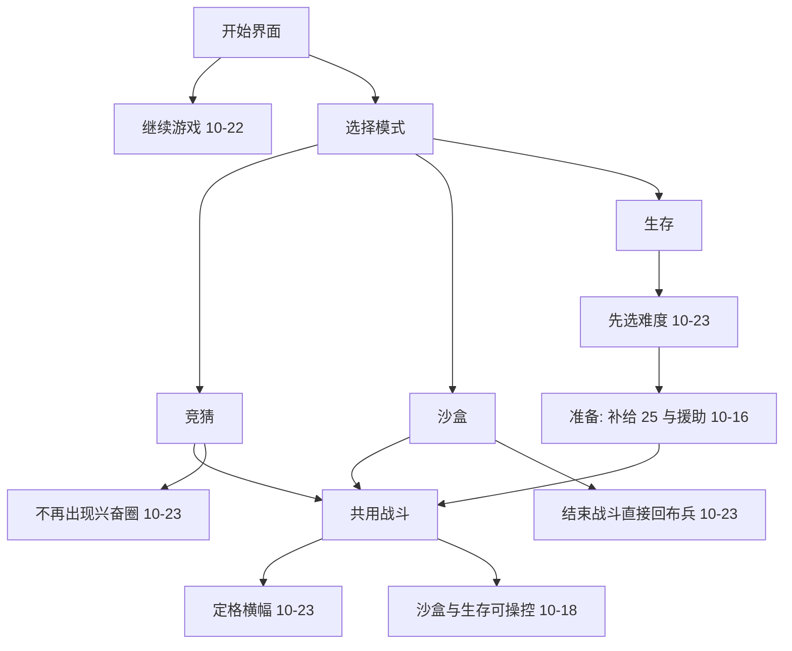

# 第 5 周作业：项目方案完善与首个可玩目标

课程：计算机图形学与游戏开发（小组项目）  
项目：《羽锋大乱斗》（Godot 4.7，工程目录 `yufengdaluandou`）  
文档日期：2026-10-28  
事实来源：`docs/bible/99_decisions.md`。后写的条目覆盖先写的句子。

**修改范围：** 只记 **2026-10-16 及以后**。10 月 15 日当天决策日志没有新条目。10 月 15 日以前已经在的竞猜、沙盒、生存、商店、等级和科技，算已有项目，不写进本次修改。

---

## 1. 一页项目提案

**组名：** 第八组
**成员分工（只覆盖本次修改）：**

| 姓名 | 负责的修改 | 主要文件 |
| --- | --- | --- |
| 陈鑫涛 | 生存：援助、波次、难度、指挥所 | `scripts/game/roguelike.gd`、`scripts/game/roguelike_aid.gd` |
| 陈相宇 | 操控、图鉴、五种场景 | `scripts/camera/camera_rig.gd`、`scripts/ui/codex_screen.gd`、`scripts/arena/arena.gd` |
| 王琳 | 设置、存档、关窗口、战斗表现：定格、兴奋圈、激光、弹道 | `scripts/ui/settings_screen.gd`、`scripts/core/user_prefs.gd`、`scripts/game/main.gd` 、`scripts/units/unit3d.gd`、`scripts/arena/arrow.gd`、`scripts/ui/hud.gd`|

**已有玩法（不在本次修改里）：** 开始界面进入竞猜、沙盒或生存。竞猜读阵押注，最多 10 轮。沙盒自己摆兵再开战。生存用补给买队，守 10 个回合，基础血量 200。三套界面共用同一批单位和同一块场地。

**本次要让玩家新感觉到的：** 沙盒和生存的战斗里可以亲自接管一个兵。进生存要先选难度。竞猜打过 60 秒不再出现兴奋圈。沙盒「结束战斗」直接回到布兵。关掉窗口时，竞猜和生存会先留下这一局。

**本次修改动到的规则：**

- 兴奋圈废止（2026-10-23，不变量 I-14）。竞猜仍保留 90 秒时限和 20 秒僵持判平。
- 生存第 1 回合补给改为 25。第 2 回合起四选一援助，可以放弃换 5 补给。敌方权重改为第 1 回合 60、之后每回合 +30（「不可能的奇迹」仍用这套；更低难度从 2026-10-23 起往下减）。
- 指挥所每升一级 +1000 血。第 4 回合起指挥所自带起始等级。遣返买价改为 5。
- 沙盒手动「结束战斗」不进战果，按原布局回到布兵。一方全灭仍进战果。

**本次范围：** 上表四栏都能在一场里指出来。生存十回合的完整配表、全部科技句子，10 月 15 日以前已经在做，不作为这次验收要逐条演示的新功能。

**暂不作为本次必演示：** 音效与结算镜头震动仍是更早文档里的待补。2026-10-28 已改代码、尚未写入决策日志的几项（全屏铺满屏幕、城市南边楼压矮、火枪弹尾和腐化师连线改成一条线、散射光束不超过小球），验收时单独说明，不并进「决策已经生效」的演示。

**最大风险：** 这些修改落在三条循环共用的出手和场地上。蓄力激光、大师对沙虫的后撤，改一处三个模式一起变。决策日志里多条复查写明还没在窗口里逐项看过，只确认过脚本检查没有解析错误。

---

## 2. 核心循环里，哪些是这次改的

三条循环本身是 10 月 15 日以前的结构。下面只标出 10 月 16 日以后改过的节点。

| 日期 | 改了循环的哪一处 |
| --- | --- |
| 10-16 | 生存第 2 回合起先选援助或放弃，才能开战。拆掉敌方指挥所且敌人还活着时补给 +10 |
| 10-18 | 沙盒、生存开战之后可以接管一个活着的作战单位。竞猜仍然只看 |
| 10-22 | 开始界面增加「继续游戏」。竞猜和生存的暂停最后一项改为「保存并退出」。沙盒仍是「主菜单」，不存 |
| 10-23 | 新开生存先选难度，默认非常简单，本局不能改。选完才刷第 1 回合的敌人 |
| 10-23 | 三个模式战斗结束后先停约 0.2 秒再出横幅。继续按 Enter，先渐黑再换场 |
| 10-23 | 竞猜不再生成兴奋圈，也不再加圈外攻速和内伤 |
| 10-23 | 沙盒「结束战斗」回到布兵。直接关掉窗口时，竞猜和生存再写一次与「保存并退出」相同的档 |

---

## 3. 首个可玩目标

已有的押注、布兵、买队不重复当成这次做出来的功能。本周要能玩到的，是 10 月 16 日以后加上的这几步。

**假设：** 不另加口头说明，玩家能在生存开局看见难度选择，在沙盒里用「结束战斗」回到布兵并看到原来的兵还在，在竞猜里打过一分钟也看不到兴奋圈。

| 任务 | 完成标准 | 状态 |
| --- | --- | --- |
| 生存先选难度 | 七档出现在初始部队之前；点「非常简单」之后才有第 1 回合的敌人 | 已实现。复查写明还没在窗口里看过 |
| 沙盒结束战斗 | 摆下的兵还在原位，中间没有战果横幅 | 已实现。复查写明还没在窗口里看过 |
| 竞猜无兴奋圈 | 超过 60 秒没有圈，顶栏没有圈倒计时；90 秒和僵持判平仍在 | 已实现。复查写明还没在窗口里看过 |
| 接管一个兵 | 沙盒或生存战斗中出现准星；竞猜不能选人 | 已实现。10-18 的复查写明还没在一场里看过 |
| 继续游戏 | 竞猜或生存「保存并退出」之后，开始界面能读回那一局；沙盒没有这一格 | 已实现。复查写明还没在窗口里看过 |
| 非组成员按第 5 节任务卡试玩 | 有独立操作记录 | 未做 |

---

## 4. 画面上这次改了什么

三个模式的顶栏、押注面板、兵种栏、商店在 10 月 15 日以前就有。镜头仍由 `CameraRig` 移动，这三套界面仍锚在屏幕上。10 月 16 日以后新出现或改过的是这些：

| 画面 | 显示什么 | 从哪天起 |
| --- | --- | --- |
| 操控条 | 屏幕正中准星，上方是血量和技能冷却。挂在共用镜头上，沙盒和生存不用各做一份 | 10-18 |
| 图鉴 | 开始界面和暂停菜单打开。19 个兵种的基础七项、技能、科技；另有援助一页。右边转模型 | 10-18，援助页 10-23 |
| 设置 | 视频、音频、地图、按键分块。视频里是全屏。按键可改镜头和操控的八个键 | 10-22，10-23 改成点一块才显示一块 |
| 难度门 | 生存准备阶段最前面的七档 | 10-23 |
| 定格横幅 | 三个模式战斗结束约 0.2 秒后，人停住，结果改成上下两条，Enter 继续 | 10-23 |
| 射程圈 | 部署时是黑色实心圆。圈里的敌人轮廓发光 | 10-23 |
| 竞猜顶栏 | 不再显示兴奋圈倒计时 | 10-23 |
| 五种场景 | 设置里勾选森林、山脉、沙漠、雪地、城市。竞猜每一轮换一次，沙盒和生存进入时定一次 | 10-18 起，抽签时机 10-19 改成竞猜每轮 |

**和镜头的关系：** 操控条跟着被接管的单位，准星仍画在屏幕正中。其余新增界面都在屏幕层上。飞镜头时，难度门、设置和定格横幅不挂到场地上。战斗定格之后按 Tab，镜头停在玩家飞到的地方，不再飞去全景机位（10-23）。押注和布兵阶段的自由视角仍会飞去、飞回。

---

## 5. 用观察支持的一次决策

只取 10 月 16 日以后的一条。2026-09-25 那次「30 秒从 0 伤害变成沙虫掉 1000 血」发生在本次修改之前，不记入本条的结果。

**2026-10-23 · 武士大师已经贴进剑程时，不再因沙虫后撤。**

**当时看到的情况（决策日志的背景）：** 大师单挑沙虫仍然一刀打不中。沙虫约 5 米外就开始前摇，大师的剑大约 2.2 米。快被咬到时后撤约 7 米，刀还没落下人已经退出剑程。

**候选：**

| 方案 | 处理 |
| --- | --- |
| 改后撤距离或冷却 | 否掉。这是更早的候选 C，会改掉对其它近战的手感 |
| 只在已经贴进自己的剑程时，不再吃沙虫这一口后撤 | 采用。拔刀斩的斩击带再加上对方的身体半径 |

三个模式共用这一段出手，所以只改这一处。

**复查：** 同一条写明还没在窗口里看过「贴住之后会砍中」。脚本 `--check-only` 没有解析错误。这一点不能写成已经在画面里看见。

---

## 6. 实现进度（仅 10 月 16 日以后）

| 状态 | 内容 |
| --- | --- |
| 已写入决策日志 | 援助与补给 25；敌方直线权重、随机兵种和侧翼；操控；图鉴；五种场景及之后的景物修订；游戏定名；雪地亮度；本机设置与改键；竞猜和生存存档、继续游戏、关窗口也存；生存七档难度；战斗定格与 Enter 渐黑；兴奋圈废止；指挥所血量与遣返价；部署实心圈；沙盒结束战斗回布兵；蓄力时不画射线、散射每根自己计档；火枪路径上的白色烟雾（日志口径是烟团）；大师贴进剑程不再后撤；散射中心球与腐化师背后的曲线 |
| 已改代码，决策日志还没有这条 | 2026-10-28：设置里的全屏会铺满当前屏幕；城市场景南边建筑压到约 3.2–6 米；火枪弹尾和腐化师背后到法球的连接改成一条线；散射光束最粗不超过那五颗小球；湮灭之瞳按当前目标核对伤害档 |
| 未做 | 第 5 节的非组成员记录。上表已实现各项里，日志复查大多写着还没在窗口里逐项看过 |

10 月 15 日以前的押注、布兵、商店和科技不列入这张表。

---

## 7. 成员与 AI 贡献

陈鑫涛、陈相宇、王琳。

| 修改 | 文件 | 怎样核对 |
| --- | --- | --- |
| 援助、难度、指挥所 | `scripts/game/roguelike.gd`、`scripts/game/roguelike_aid.gd`、`scripts/ui/roguelike_hud.gd` | 新开生存先看到七档；第 2 回合出现四条援助 |
| 操控与图鉴 | `scripts/camera/camera_rig.gd`、`scripts/ui/codex_screen.gd` | 沙盒战斗中出现准星；开始界面能打开图鉴；竞猜不能选人 |
| 场景 | `scripts/arena/arena.gd` | 设置里五个勾选；竞猜下一轮背景会变 |
| 存档与关窗口 | `scripts/game/main.gd`、`scripts/ui/pause_menu.gd` | 竞猜或生存保存后再从「继续游戏」进入；沙盒没有这一格 |
| 兴奋圈、定格、结束战斗 | `scripts/arena/arena.gd`、`scripts/game/sandbox.gd`、`scripts/ui/hud.gd` | 竞猜无圈；三个模式结束时先定格；沙盒结束战斗回到布兵 |
| 激光、烟雾、后撤 | `scripts/units/unit3d.gd`、`scripts/arena/arrow.gd` | 蓄力时没有线；火枪路径上有痕迹；大师贴住沙虫时不再被这一口撤走 |

**AI 辅助：** 用于对照 10 月 16 日以后的决策、改对应脚本，以及把本文收成只含这一段修改。10 月 15 日以前的实现不记成这次的 AI 产出。改完脚本后用过 Godot `--check-only`，没有解析错误。日志写明没在窗口里看过的项，这里也不写成已经看见。已经否掉、且日期在这段里的例子：不把蓄力改成曲线走完才开始计时；不给沙盒在关窗口时另写存档；不改后撤距离来打沙虫。

---

## 8. 验收时打开的工程

打开 `D:\godot\program\yufengdaluandou`。用第 3 节的三件事演示本次修改：生存的难度门、沙盒的「结束战斗」、竞猜里没有兴奋圈。三条循环的押注、摆兵、买队只作为这些修改的落点，不把它们讲成 10 月 16 日以后新做的。试玩若仍空着，说明缺的是非组成员记录。第 6 节的大师后撤是开发侧记录，而且窗口复查还没做。
